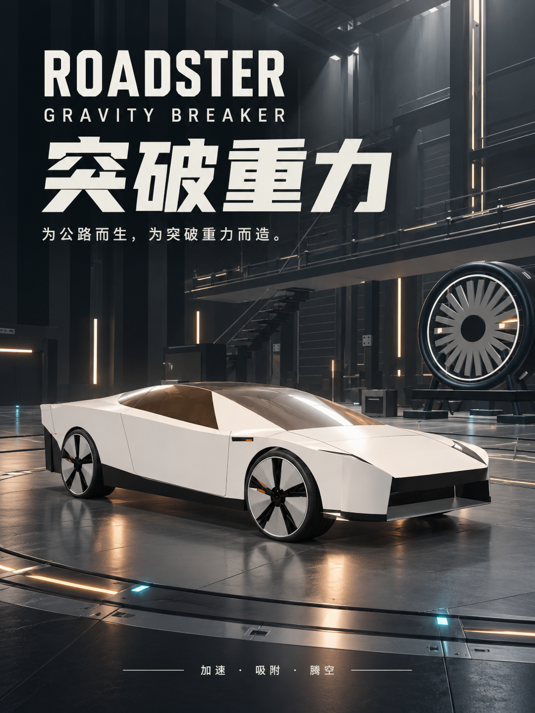
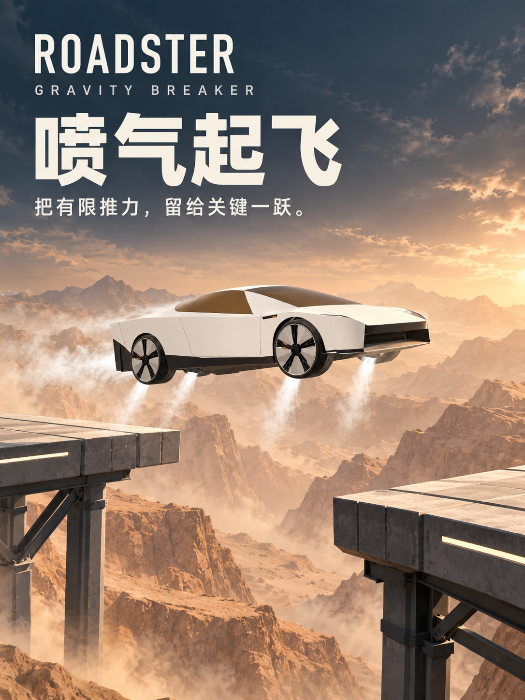
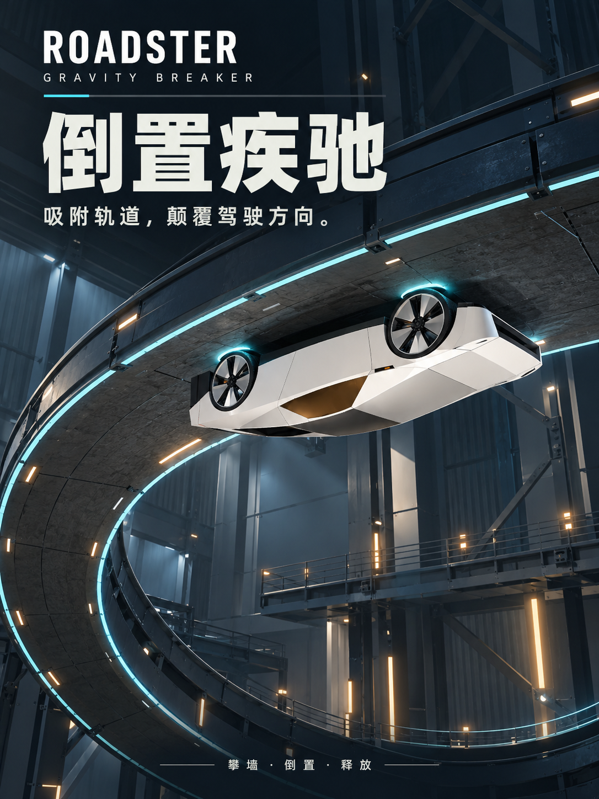
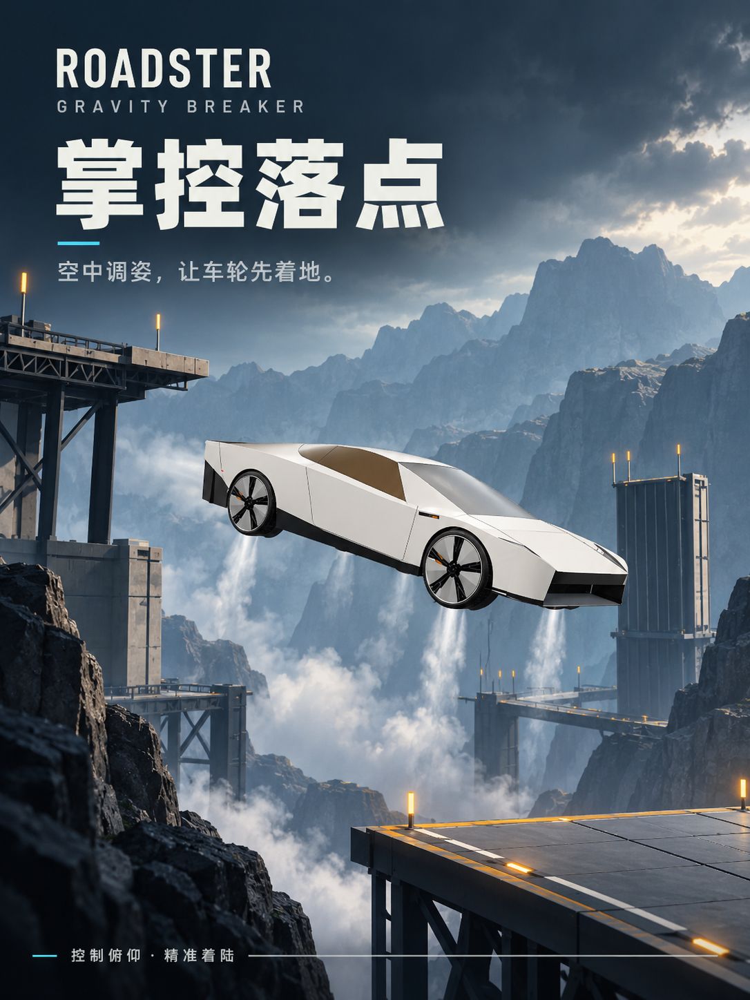
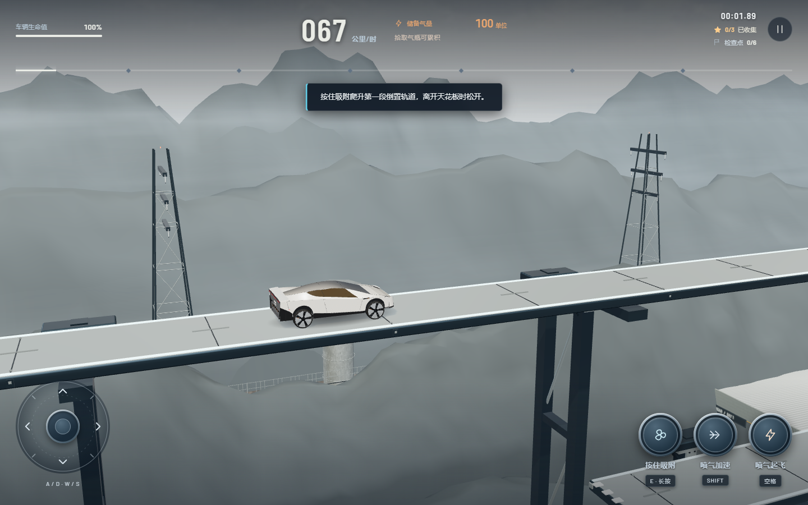
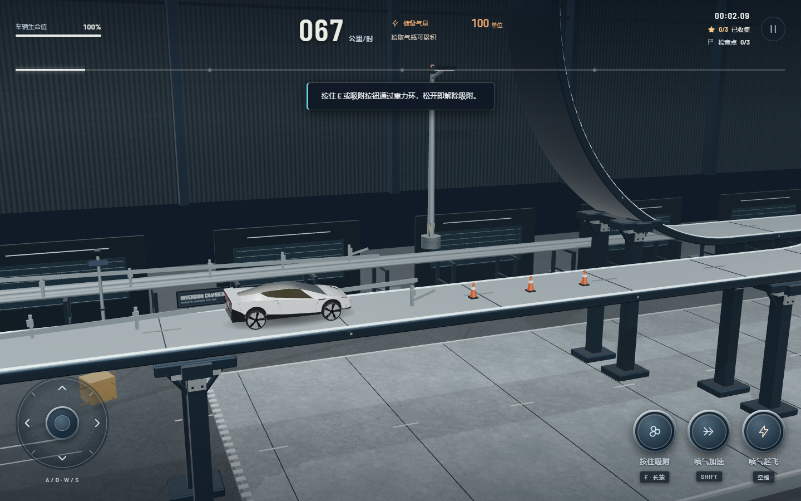
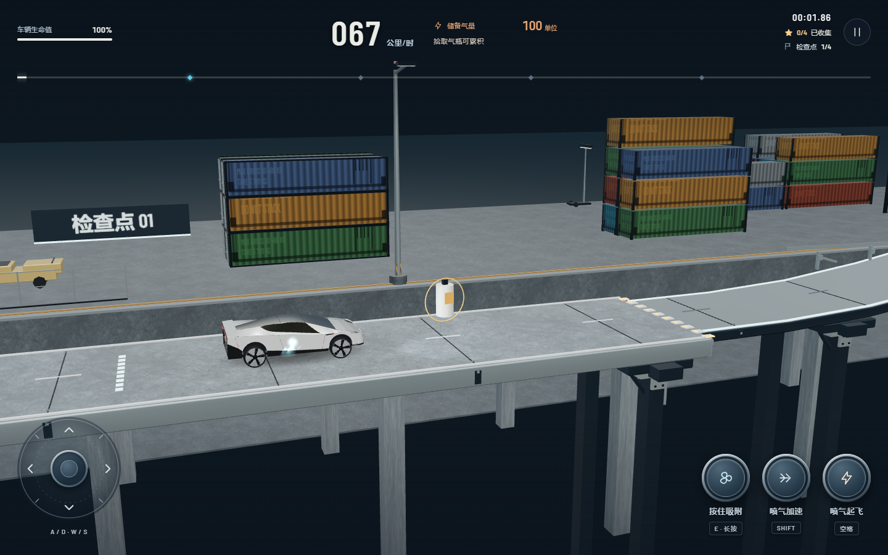
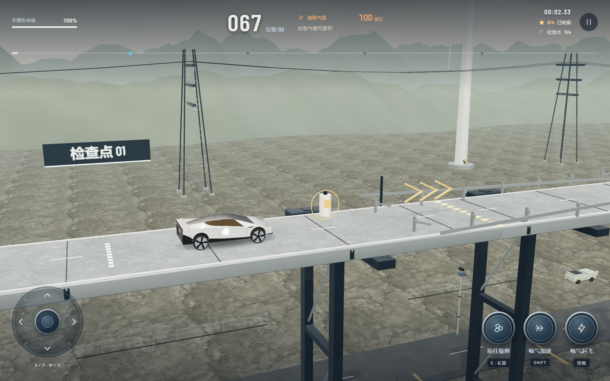
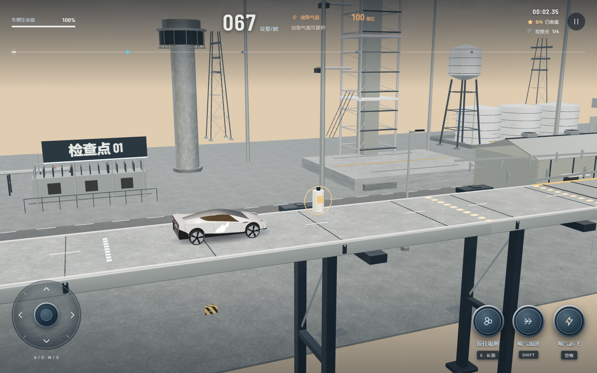
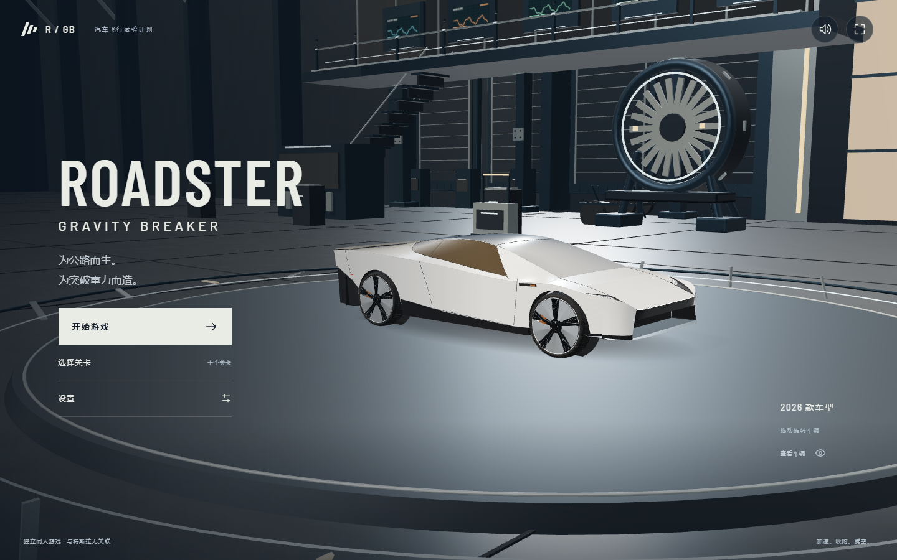

<div align="center">

# Roadster: Gravity Breaker

<table>
  <tr>
    <td></td>
    <td></td>
    <td></td>
    <td></td>
  </tr>
</table>

[](LICENSE)
[](https://threejs.org)
[](https://vitejs.dev)

### [在线游玩](https://roadster-game.app.workbuddy.host/?sharecode=PBTM42ZG27)

</div>

一款 2.5D 物理特技驾驶游戏，玩法参考 2026 年 10 月发布的新一代特斯拉 Roadster：车辆可以贴在垂直坡道上倒挂行驶。同人作品，非官方，与 Tesla, Inc. 无关联。

技术栈为 Vite + TypeScript + Three.js + Rapier 2D。纯前端实现，没有后端和账号系统，构建产物是静态文件，任意静态托管都能跑。支持桌面键盘和手机触屏，界面有中文和英文两种语言。

无需自己部署也能玩：浏览器打开[在线版本](https://roadster-game.app.workbuddy.host/?sharecode=PBTM42ZG27)即可。

## 玩法

车辆有三种能力，围绕它们设计全部关卡：

- **冷气推进**：向上喷气起飞，气压有限，随时间消耗，捡拾气瓶补充。
- **风扇吸附**：在有效路面附近长按吸附，车辆贴住路面，包括垂直坡道和倒挂面；松开即脱离。
- **俯仰姿态**：控制车头仰角，用于空中翻转和调整落地姿态。

共 10 个关卡。每个关卡有独立场景、检查点、奖牌（限时、零失败、剩余生命过半）和挑战星（前 3 关各 3 枚，后 7 关各 4 枚，共 37 枚）。生命耗尽或跌出关卡判负，可从检查点复活或重试。

关卡中有 35 处脚本化动态路障：弹射电池（触碰即毁）、刹车失灵的失控车辆、静止货车路障等。

## 截图

<div align="center">
<table>
  <tr>
    <td></td>
    <td></td>
  </tr>
  <tr>
    <td></td>
    <td></td>
  </tr>
  <tr>
    <td></td>
    <td></td>
  </tr>
</table>
</div>

## 关卡

| # | 关卡 | 场景 |
|---|---|---|
| 01 | Ignition | 沙漠试验场 |
| 02 | Inversion | 重力实验室 |
| 03 | Skyfall | 航天峡谷 |
| 04 | Aftershock | 海岸高架 |
| 05 | Vertigo | 垂直巨构 |
| 06 | Freightline | 集装箱码头 |
| 07 | Blackout | 无光廊道 |
| 08 | Crosswind | 高山风场 |
| 09 | The Needle | 天针 |
| 10 | Terminus | 发射场 |

每个场景独立搭建，配景按真实尺度建模：1 世界单位 = 1 米，20 ft 集装箱 2.59 m 高，风机轮毂 90 m。

## 快速开始

需要 Node.js 20.19+ 或 22.12+。

```bash
npm ci
npm run dev
```

打开 **http://127.0.0.1:5173**。音频在首次交互后启动，进度和设置保存在本机浏览器。建议横屏，竖屏会弹出转向提示。

```bash
npm run build
npm run preview
```

预览运行在 **http://127.0.0.1:4173**。把 `dist/` 的内容部署到任意静态 HTTPS 主机即可，资源使用相对路径，支持子目录托管。

## 操作

| 动作 | 桌面 | 触屏 |
|---|---|---|
| 加速 | D / → | 左摇杆向右 |
| 刹车 / 倒车 | A / ← | 左摇杆向左 |
| 冷气推进 | 空格 | 按住「喷气加速」 |
| 风扇吸附 | 按住 E | 按住「按住吸附」 |
| 抬头 / 低头 | W / S | 左摇杆上下 |
| 地面加速 | Shift | 按住「地面加速」 |
| 重试检查点 | R | 重试按钮 |
| 暂停 | Esc | 暂停按钮 |

斜向推动摇杆同时叠加驾驶与俯仰，灵敏度可在设置中调整。

## 测试

```bash
npm test                # 确定性物理测试
npm run test:physics    # 完整输入重放路线
npm run test:e2e        # 真实浏览器端到端
```

端到端覆盖桌面键盘、多点触控、完整关卡重放、菜单与存储。若 Playwright 缺少浏览器，先运行 `npx playwright install chromium`。

## 实现

物理以 120 Hz 固定步长模拟，包含悬架、有限气压推进、主动俯仰和近面吸附。车辆为程序化几何：源模型在 `src/render/vehicle.ts`，`assets/roadster-2026.glb` 是其导出的静止姿态（含命名机械组），可用 `scripts/export-vehicle.ts` 重新生成。场景几何全部运行时生成，贴图来自仓库内 CC0 扫描与 Canvas 程序化贴图。

## 素材授权

| 素材 | 来源 | 授权 |
|---|---|---|
| 代码、车辆与场景几何 | 本仓库原创 | MIT |
| 背景音乐 | Alexander Ehlers (tricksntraps) | CC0 1.0 |
| 环境贴图 | Poly Haven | CC0 1.0 |
| 厢式货车模型 | Innerscene | CC0 1.0 |
| 字体 | Barlow / Barlow Condensed / Noto Sans SC | SIL OFL |

第三方授权全文见 [`public/licenses/`](public/licenses/THIRD-PARTY.txt)。

## 免责声明

本项目为同人作品，非官方。与 Tesla, Inc. 无关联，未获得其授权或背书，不使用其商标与 logo。车辆为基于公开报道的原创美术演绎，不是官方模型；游戏内的物理调校不构成对任何真实车辆性能的描述。游戏文案均为虚构。

## License

[MIT](LICENSE)
